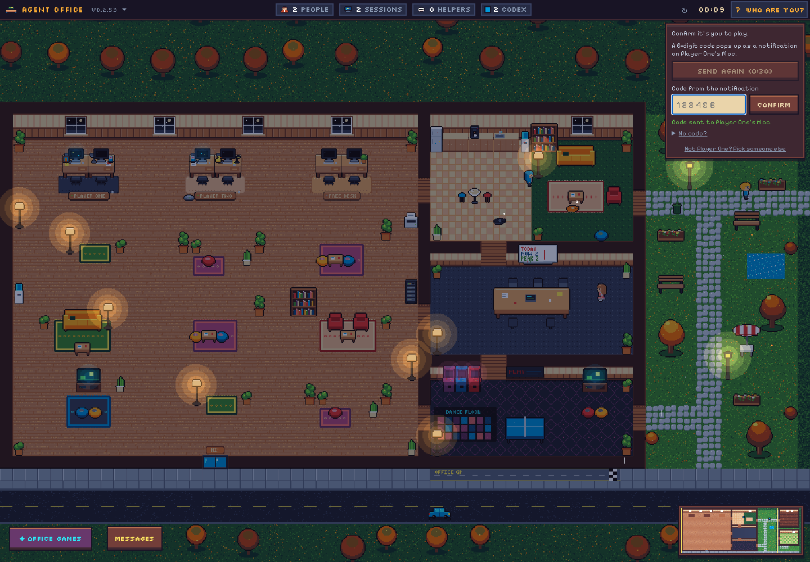
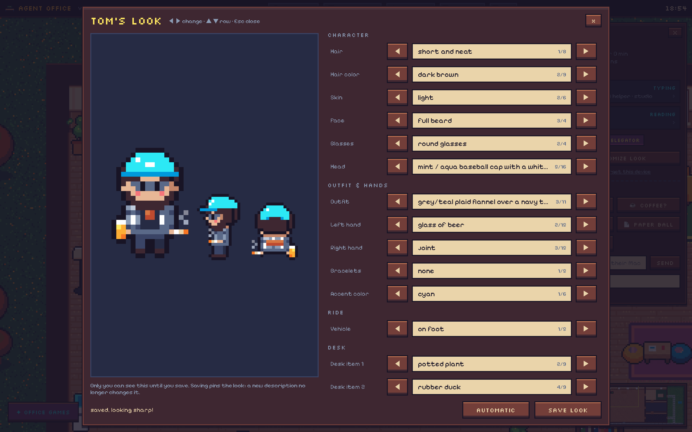
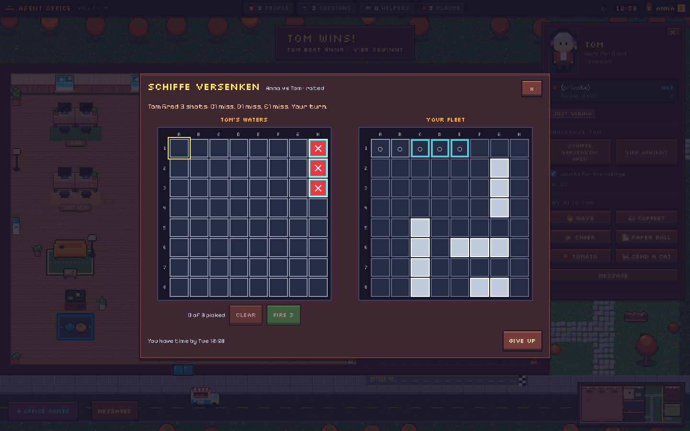
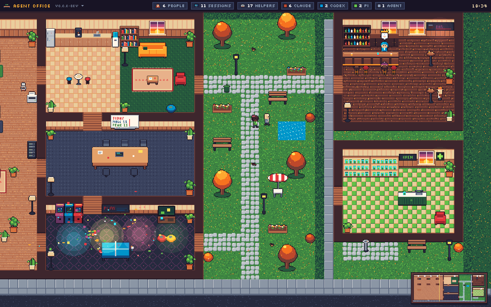

# Agent Office

A cozy pixel-art office that shows, live, who on the team is working with which coding agent.
Every teammate is a character; every running Claude Code, Codex or Pi session is another desk
with them at it, typing, reading, thinking, or raising a hand when the agent waits for input.
Subagents scurry around as little bots.


> **Coding agent reading this?** Your human probably sent you this link plus a server URL and
> a password and asked "what is this, set it up for me". Explain it in two sentences (a live
> pixel office of the team's coding agents; only status metadata is shared, never code or
> prompts), then follow [Instructions for coding agents](#instructions-for-coding-agents).
> If they didn't give you the server URL or password yet, ask for them.

A small connector on each Mac watches local agent sessions (read-only, from the agents' own
transcript files) and reports *status only* to a Cloudflare Worker, which renders the office
for everyone.

## Join the office (teammates)

You need two things from whoever runs the office: the **server URL** and the **password**.
Then just send your coding agent this repo link with both and ask it what this is and to set
it up for you.

### Easiest: let your coding agent do it

Paste this into Claude Code (or Codex / Pi), with the two values filled in:

```text
Set up Agent Office on this Mac for me (only the connector, no server).
Server: https://<server-url>
Password: <password>
Follow the "Instructions for coding agents" section in
https://github.com/MrGatzi/agent-camp/blob/main/README.md
When I'm connected, open the office in my browser.
```

Your agent will ask you a few quick questions (your name, how you look, a name for this
machine), install the connector, check that you show up in the office and open it in your
browser. Approve the network and `launchctl` commands when it asks. The office asks for the
same password the first time you open it.

Paste it where Claude can run commands on your Mac: the **Code** tab of the Claude desktop
app, or Claude Code in a terminal or IDE. A normal chat or Claude Design can't install it. The
office shows sessions of Claude Code (in a terminal, an IDE or the Code tab of the Claude
desktop app), Codex and Pi running on your Mac. Designers who work in
Claude Design in the Claude desktop app can get a desk too, and so can older Cowork sessions,
if you turn them on (see [Claude Design and Cowork](#claude-design-and-cowork)). claude.ai
chats run in the cloud and don't appear.

### By hand

```sh
curl -fsSL https://github.com/MrGatzi/agent-camp/releases/latest/download/install.sh | sh
```

It asks five things: the **server URL**, the **password**, your **name**, an optional
**description** of your look that shapes your avatar (a few words like "curly hair, round
glasses", or a detailed paragraph), and a **name for this machine** (defaults to its short
hostname). Done: the connector runs in the background (launchd), starts at login and updates
itself. Re-run the same line any time to change answers.

A long description is easier in a file: `agent-office configure --description-file ~/look.md`
(or `AO_DESCRIPTION_FILE=~/look.md` for the installer), then
`launchctl kickstart -k gui/$(id -u)/dev.agentoffice.connector` so the office redraws you.
Don't hand-edit a multi-line description into `config.toml` as a TOML `"""…"""` string:
the connector reads only single-line values there, so use `configure --description-file`
(it stores line breaks escaped).

```sh
agent-office status      # connected? which sessions does it see?
agent-office status --json # machine-readable, privacy-safe health snapshot
agent-office logs        # follow the log
agent-office uninstall   # stop and remove everything
```

`status --json` prints exactly one JSON object (`schemaVersion: 1`): `connectorVersion`
(the CLI version), `daemonRunning`, `connected`, `updatedAt` (epoch milliseconds, or `null`
when missing/invalid), and `sessions`. A daemon is running only with a live positive PID and
a status update less than 10 seconds old (not future-dated); connected also requires an open
socket and the server's welcome. Stale/dead daemons have no sessions. Sessions contain only
`agent`, `activity`, `subagents`, `startedAt`, and optional numeric `context` (0–1)—no project
names, identifiers, config, server URLs or errors. Missing/corrupt status is reported as
not running. Like text status, this exits 0 even when disconnected; check the JSON booleans
for health checks.


### Instructions for coding agents

You are setting up the Agent Office connector for the human you are working with. They gave
you a server URL and a password. Do this:

1. Check the machine: `uname -sm` should say `Darwin arm64` or `Darwin x86_64` (macOS only).
2. Ask the human, in one message, and wait for the answers:
   - **Display name** shown in the office (first name is fine). If they already run Agent
     Office on another machine, it must be the **same name** there so both count as one person.
   - **Look** (optional): a few words ("curly hair, round glasses, hoodie") or a detailed
     paragraph (hair, glasses, each piece of clothing with colours, shoes, pose; up to ~8000
     characters). See [How do I look?](#how-do-i-look).
   - **Machine name** (optional): a label for this computer, default `hostname -s`
     (e.g. "laptop", "devbox").
   - **Share project folder names?** (default yes). Only the folder's base name is ever sent.
3. Install without prompts (the env vars must be on `sh`, not on `curl`):
   ```sh
   curl -fsSL https://github.com/MrGatzi/agent-camp/releases/latest/download/install.sh \
     | AO_NONINTERACTIVE=1 AO_SERVER='<server-url>' AO_PASSWORD='<password>' \
       AO_NAME='<name>' AO_DESCRIPTION='<look or empty>' AO_MACHINE='<machine name>' sh
   ```
   The binary lands in `~/.local/bin/agent-office` and a launchd agent
   (`dev.agentoffice.connector`) starts it now and at every login. This needs network access
   and `launchctl`; if your sandbox blocks them, ask the human to approve or to run the command.
   For a look longer than a line (or with quotes or line breaks), write it to
   `~/.config/agent-office/look.md` and pass
   `AO_DESCRIPTION_FILE="$HOME/.config/agent-office/look.md"` instead of `AO_DESCRIPTION`.
   To change the look later:
   ```sh
   ~/.local/bin/agent-office configure --description-file ~/.config/agent-office/look.md
   launchctl kickstart -k gui/$(id -u)/dev.agentoffice.connector
   ```
4. If they said **no** to project folder names:
   ```sh
   ~/.local/bin/agent-office configure --share-project-names false
   launchctl kickstart -k gui/$(id -u)/dev.agentoffice.connector
   ```
5. Verify: run `~/.local/bin/agent-office status`. It must say **connected** and should list
   this very session (it needs a transcript write in the last 90 s, so check after a moment).
   If it is not connected, look at `~/.local/bin/agent-office logs` (Ctrl-C to stop): a
   rejected password means a typo; a connection error usually means a wrong URL (use the
   `https://` address of the office).
6. If `~/.local/bin` is not on their `PATH`, offer to add it to `~/.zshrc`.
7. Open the office for them: `open '<server-url>'` (it asks for the same password once).
   Tell the human it worked and that they can watch at the server URL in any browser.
   Don't echo the password back in your summary.

The connector only reads agent transcript metadata and never sends prompts, code or file
contents (see Privacy below), so no other setup is needed.

### Two machines, one you

Run the connector on every machine you code on (laptop, remote devbox, ...) and give it the
**same name** everywhere: the office matches people by name (case and extra spaces don't
matter), so you stay one character with one look, and the sessions from all your machines
sit side by side in your pod. The description only needs to be set on one machine; a machine
without one never changes your look, and the last description you set wins. The machine
name (`agent-office configure --machine-name devbox`, or `AO_MACHINE=` for the installer)
shows up on the agent card so you can tell the sessions apart.

### Claude Design and Cowork

For teammates who work in the Claude desktop app instead of a terminal.

**Claude Design** runs on Anthropic's servers inside the Claude app, so the connector can't
see whether you are designing or what Claude is doing. If you are a designer and the Claude
app is where you do your design work, say so once:

```sh
agent-office configure --claude-app design
launchctl kickstart -k gui/$(id -u)/dev.agentoffice.connector
```

From then on, while the Claude app runs you have exactly one pink "Claude Design" desk:
**thinking** while the app is in front, **idle** after it has been in the background for two
minutes, and gone when you quit the app. It never shows "waiting", because the connector
can't know that. No permission is needed, and nothing in the Claude app changes: the connector
only checks that the app runs and asks macOS (`lsappinfo`) which app is in front. Cowork
sessions are not shown with this setting, so you stay one desk. `agent-office configure
--claude-app off` turns it off.

**Cowork** is off by default, because it is often not coding work. Turn it on with
`agent-office configure --cowork true` and restart the connector. Each Cowork session whose
transcript is on your Mac is then a Claude desk with the project name "Cowork" and real
activity. A quiet session keeps its desk for 30 minutes. Current versions of the Claude app
run Cowork chats inside the app's own virtual machine and keep their transcripts there, so
those don't show up.

### How do I look?

Your look is drawn by AI from your description. If you opt in, the AI is **your own**: the
connector asks Claude Code (`claude -p`, with no tools, MCP servers or hooks) on your Mac, on
your own subscription, so the office needs no shared API key. This is **off by default** (it
spends your subscription); turn it on with

```bash
agent-office configure --look-generator auto   # or claude; off turns it off
launchctl kickstart -k gui/$(id -u)/dev.agentoffice.connector
```

Only your description goes to your AI and only the finished look goes to the office. With it
off (or without Claude Code), the office's own AI draws your look if the admin set one up
(`GENUI_PROVIDER`), else it comes from a hash of your name. `agent-office status` shows
whether your Mac draws looks; updates and reconnects never turn it on.
The description: a few words work, but a detailed one (up to ~8000 characters)
gets you a detailed character: hair cut and colour, glasses and their frame, each layer of
clothing with its collar, buttons, pockets, pattern and embroidery, socks, shoes, even an
expression and a pose. Exact colours (`#1f3d2b`, "forest green") are used as given. All of it
is painted by the same renderer at the same pixel size, so everyone stays in one style.

Which agent a session runs (Claude, Codex, Pi, Claude Design) shows in its colour: if you
don't name a jacket colour, your jacket takes the agent's colour as before; if you do, you
keep your jacket and get a badge on the chest (and a patch across the shoulders from behind)
in the agent's colour instead. Every extra
session is a sibling of you with tiny variations, and your pod has one desk per running
session (at least 2, up to 6). With more sessions than desks, the working ones sit at the desks
and the long-idle ones get up and roam.

Want a say? Tell the office who you are: tap **Who are you?** in the top bar, pick your
character and **Send a code to my Mac**. A 6-digit code pops up as a notification on your Mac
(via the connector, so its notifications must be allowed in macOS; if nothing shows up, send
again after 30 s), and typing it in marks this browser as you. The top bar then shows your
portrait; its menu has **Customize look**, **My desk** and "Forget this device". A browser
that is nobody (a guest, the kiosk) only watches and can say hi with a typed name.



**Customize look** opens a fullscreen studio showing the look you wear now, with two tabs,
one per way to a look. You can only change your own look. This is a courtesy lock for a team
office, not real identity: anyone with the office password could start a connector under your
name. On a shared device, "Forget this device" in that menu (or logging out) drops the claim.

**Design it**: change every part of the look you wear now (your AI look too) and give each
part its own colour. Tabs for **Outfits** (one click into a business suit, tuxedo, dirndl,
lederhosen, kilt, ball gown, swimwear, underwear, naked, chef, superhero, witch, pirate, Santa,
ninja, cowboy, and crazier: mermaid, knight, wizard, luchador, tourist, clown, storm god and
more, plus **🎲 Surprise me**), **Body** (height, build, figure, skin colour, pose), **Face**
(eyes, mouth, makeup), **Hair** (cut, colour, dyed tips, beard), **Head** (hats from top hat
to Tirolerhut, glasses, earrings, masks), **Top** (underwear, shirt, vest or bodice, jacket or
coat, patterns, buttons), **Bottom** (underwear, trousers or skirt, apron, socks or tights,
shoes), **Extras** (held items in any colour, wings, tails, gloves, necklaces, bags, a pet on
your shoulder, an aura around you) and **Desk & ride**. Flip a part with ◀ ▶ (or the arrow keys); the swatch
next to it opens the colours (or any colour you like). **Save look** pins the design with
all its detail, **Undo changes** drops what you have not saved. Naked is a smooth, featureless
doll body. Clothes that are not in the agent colour carry a small agent badge on the chest
and a band across the back, so you can still tell Claude from Codex at the desk.

**Describe it**: write how you look (a few words or a whole paragraph) and press **Generate
look**; the Mac you confirmed **It's me** on draws you from it (as above) within a minute or
two, replacing a saved design. **Change something** edits the look you wear now instead
("make my jacket red, add a cowboy hat") and keeps everything else; **Undo that change**
brings the old look back. The new look goes live as soon as it is drawn, there is nothing
to save. While you wear your own design, this tab offers the way back: **Use the look from my
description** (or **Back to the automatic look** if you never wrote one). Only that Mac
draws: each Mac gets its own code, so another connector started under your name never gets
your text, and a description a connector sends when it connects never runs on any Mac. If
your Mac cannot draw it, the tab says why and how to fix it: it reconnected since you
confirmed (sleep, restart: confirm **It's me** again, right there with a new code), it has no
look generator yet (`agent-office configure --look-generator auto`, which restarts the
connector), or it is not connected. Meanwhile the office's AI draws, if it has one. If Claude
Code fails on your Mac (often: not logged in there), the studio shows its error as soon as
the Mac answers. Pressing it again with the same text is a fresh try (one per person every
20 s, and one at a time: a new one waits until the last one is drawn). Without a Mac that can
draw it, the office's own AI draws it, at most 5 times per person per day
(`GENUI_MAX_CALLS_PER_PERSON`), so nobody uses up the shared daily cap; looks drawn on your
own Mac do not count. Like editing your look, this needs **It's me** first: only your own
browser can ask, only that Mac's answer is taken. The text becomes your description, just
like one set with `agent-office configure --description-file` (a connector that keeps sending
its old, unchanged description does not undo it). If AI looks are off on the server, the tab
says so and the text is kept for when they are turned on (`GENUI_PROVIDER`, see Deploy).



### A GIF over your head

Pick any GIF on [giphy.com](https://giphy.com), copy its link and run:

```sh
agent-office gif https://giphy.com/gifs/cat-typing-JIX9t2j0ZTN9S
agent-office gif          # show the current one
agent-office gif off      # remove it
```

It floats over your main character (your oldest session) for everyone watching. Page links,
media links (`media.giphy.com/...`, `i.giphy.com/...`) and bare ids all work; the command
restarts the background connector so it shows up right away. Like the description, it
belongs to the person: the last machine that set one (or `off`) wins, and a machine that
never set one leaves it alone. Only the Giphy id is sent; viewers load the GIF straight from
Giphy's CDN (no referrer, no cookies), so every screen showing the office contacts Giphy. GIFs
are not rating-filtered: a screen that should never show them (the wall, a meeting room) adds
`?gifs=0` to its URL, which hides every head GIF there and loads nothing from Giphy.

You can also do it from the office page: confirm who you are once (**Who are you?** in the
top bar; a code pops up on your Mac, the same step as for the look editor), open **My desk**
from that menu or click your nameplate, then paste a Giphy link under
**GIF over your head** and press **Save** (you see a preview first). **Remove** clears the GIF.
Only your own GIF can be changed this way. A GIF set on the page sticks across connector restarts and reconnects, until
you run `agent-office gif ...` again with a different value (or `off`). The wall/iPad
kiosk (`?kiosk=1`) and the demo (`?demo=...`) don't show this section.

To take down someone's GIF without their **It's me** (say, an unfortunate pick on the wall),
anyone with the connector password can remove it. The person id is their name as a
lowercase slug ("Anna Müller" → `anna-muller`):

```sh
curl -X PUT https://<office>/api/people/<personId>/gif \
  -H "Authorization: Bearer $CONNECTOR_PASSWORD" \
  -H "content-type: application/json" -d '{"link":null}'
```

### Privacy

Sent: agent kind (Claude/Codex/Pi), a salted hash of the session id, the project **folder
name** (turn off with `share_project_names = false` in `~/.config/agent-office/config.toml`),
an activity verb (typing/reading/thinking/running/waiting/idle), the subagent count, how full
the context window is (a percentage), when the
session started, the connector version, the **machine name** you chose (`machine_name`,
defaults to the short hostname, e.g. `martins-mbp`; set it to anything you like), and your
**look description** (up to 8000 characters, if you set one). The server keeps the
description to draw your avatar and never shows it to viewers; they only see the finished
avatar. A description your connector sends is drawn by the office's AI provider, if one is
set. One you write in the look studio goes to the Mac you confirmed **It's me** on, whose
Claude Code (your own account, if you opted in) turns it into the look, which the connector sends to
the office; only when that Mac cannot does it go to the office's AI provider.
The Giphy id of your head GIF is sent too, if you set one.

With `claude_app = "design"` (see [Claude Design and Cowork](#claude-design-and-cowork)),
the connector sends one Claude Design desk while the Claude app runs, with only "the app is
in front or not" as its activity. Nothing about its windows or content is read. With
`cowork` on, Cowork sessions are sent like Claude Code sessions, with the project name always
"Cowork".

Optional: `agent-office configure --birthday MM-DD` and the office brings you a cake that day
(only "it's your birthday today" is ever shown, never the date).

Fun: every live subagent shows up as its own little helper scurrying around your desk (a
background subagent stays until it is done, even when it is quiet for a while). They
are robots by default; `agent-office configure --helpers cats` turns them into kittens
(`--helpers robots` switches back). Restart the connector to apply it:
`launchctl kickstart -k gui/$(id -u)/dev.agentoffice.connector`.

The IT guy lives in the wooden server cabin in the garden. Every few minutes the
cabin catches fire and he runs out with the extinguisher. Every minute or so a developer
shouts for more RAM (the one whose agent's context window is fullest goes first); the IT guy gets
a stick from the cabin and slots it into the server rack on the desk floor. He is drawn in every browser
and needs no data, so nothing about him is sent anywhere.

Received: waves, short legacy messages, cat visits, "your turn" notices of the turn-based
games and office messages with
**Also notify recipients’ Macs** enabled are queued to connected Macs (at most one
notification every 5 s on the connector; macOS may list it under "Script Editor"). Turn
desktop notifications off with `agent-office configure --notifications false`. Saving a
message never depends on whether macOS displays an alert; offline alerts are not queued
or replayed.

Never sent: prompts, responses, code, file contents or paths, commands, tool output, or
anything else from a transcript. A unit test feeds a transcript containing a fake secret and
checks it never appears in any outgoing message. **Activity/statistics history** keeps only
events (who, which agent, project folder name, subagent counts), never transcript content.

**Explicitly authored office messages are different:** their text, optional display-name
signature and recipient names are stored in a separate shared office log. Messages are
readable for **24 hours or the latest 100 messages, whichever is smaller**. Expired bodies
are purged in hourly batches (at most **25 hours** of physical storage). Everyone with
office access can read every message, including selected-recipient messages. Recipients
control notifications, not read access; typed sender names are not verified identities.
Office Messages bodies are not stored in browser localStorage, the offline cache, activity
CSV or world/timelapse textures. The sending browser can delete a message: the entire row
is erased immediately, without a delivery/retry ledger. The legacy short-message interaction
remains transient as before (including its world bubble), not part of this shared log.
Deletion ownership uses a private HttpOnly browser cookie (only its hash is stored), not
the typed name or the look-editor identity. Keep that browser's cookies to retain deletion
rights; clearing them loses those rights. Already queued Mac notifications cannot be recalled.

## Office games and extra look items

Use the existing **Customize look** editor (your portrait in the top bar)
to choose ears, costumes, neon bracelets, both hand items, accent colors and a ride. There is
one `AvatarSpec` and one editor: saved looks keep the existing custom/automatic behavior and
appear on every sibling session. The front, side and seated previews include the new items;
a separate ride preview appears when a vehicle is equipped. Existing automatic looks stay unchanged.

The games panel adds:

- **Use left/right item:** swing a lightsaber, fire confetti, toast a beer, puff cigarette/joint
  smoke, blow bubbles, flash a disco ball, cast stars, bounce a balloon, spray water,
  shake maracas, shelter under umbrella rain, raise a skull in a green haze, or use the existing
  phone/coffee props.
- **Dance / Wave:** send a visible shared gesture.
- **High-five:** choose an online buddy; both earn one party point.
- **Play tag:** choose an online buddy; send a tag spark and earn one point.
- **Roll & race:** equip a car, skateboard, hoverboard or spaceship; a server dice roll
  moves the ride along the Office GP strip and awards 1–6 points on the shared board.

The panel uses the existing office login; there is no additional password field. You play as
the person this browser is confirmed to be (the portrait in the top bar); a browser that is
nobody is asked "Who are you?" first. The server checks it too: a move needs the "It's me"
cookie of the person it is for.

**No polling:** party state joins the existing viewer WebSocket snapshot, and successful moves
broadcast `party.updated` on that socket (including to kiosks). Opening or leaving the games
panel idle creates no extra HTTP requests or periodic server alarms. Only a deliberate move
sends one POST. Every party POST is rate-limited per IP to one attempt per 1.2 seconds before
body parsing, including malformed attempts; every actor also has a 1.2-second cooldown.
The short IP limit is in memory; actor cooldowns survive restarts. Both return `429` with `Retry-After`. Hand items, vehicles and race rolls
are server-owned; requests cannot forge equipment or points. Total hosting usage still depends
on visitors, existing office traffic and intentional actions; rate limits cannot guarantee
an entire deployment remains within its provider's free allowance.

Points persist; effects expire after 15 seconds and never replay on later presence events.
Textures/particles are bounded and reduced-motion preferences are respected. `?demo=party`
uses the same UI locally without sending moves to the server. Deploy web and server together;
no connector update or AI key is required.

### Schiffe versenken and Vier gewinnt (turn-based games)

Two games for two, played a move at a time whenever you get to it. Click a colleague's
nameplate and pick a game under **Challenge**; they find the invite on their portrait in the top
bar (a number shows how many games wait for you) and in **✦ Office games** under **My games**.
Anybody can watch a running game from **Live games**; results and records are listed below.

- **Schiffe versenken:** an 8×8 board and four ships (4, 3, 3, 2) that may not touch, not even
  at a corner. Your fleet starts placed at random: pick a ship, pick a cell to move it there,
  **Rotate** or **Shuffle**, then **Ready**. Each turn you pick 3 cells and fire them together;
  a hit gives no extra shot. Whoever starts opens with 2 shots (with 3, the side that starts
  won 60% of simulated games; with 2 it is 53%). The cells around a sunk ship are marked as
  water. A game takes about 10 to 13 turns each.
- **Vier gewinnt:** 7 columns, 6 rows, four in a line wins. On a phone the first tap shows
  where the disc lands, the second one drops it.



How it behaves:

- **You play as yourself.** Challenging, answering and moving need the "It's me" confirmation;
  a browser that is nobody can only watch. Your fleet is sent to your own browser only: not to
  your opponent, not to people watching, not into anything every viewer receives. When a game
  is over both fleets are shown. This rests on the same courtesy lock as the look editor.
- **No clock that beats you.** You have three days for a move, and Saturdays and Sundays (in
  the office time zone) do not count. After that nothing happens by itself: the player who
  waits may **claim the win**, **call it off** or simply keep waiting. An invite nobody
  answers runs out after the same time; a game nobody touched for 14 days ends without a
  result. After a few hours of waiting you can **ask for the move** once a day.
- **Friendly by default.** Tick "counts for the ratings" when you challenge and the invite
  says so; only such games move the ratings (Elo, start 1000, shown with a "?" for the first
  five). Wins, losses and draws are counted for every finished game. Whoever lost the last
  game of a kind starts the next one. You can have three open games, one per colleague and
  kind.
- **Notifications on your Mac** come from "Office games" when it is your turn, at most one
  per 30 minutes (several games are bundled into "3 games are waiting for you"). They wait a
  minute first and are dropped if you have the office open, because the page already shows
  it. A person asking for your move goes out at once. Switch them off in your portrait's
  menu ("Your turn" on my Mac).
- **Keyboard and screen readers:** the boards are grids you move through with the arrow keys
  (or type a coordinate like `C4`); every cell says what it is ("C4, hit"), states differ by
  symbol and not only by colour, and a status line says what the other side just did. Esc
  closes the board. `/?game=next` opens the game that waits for you.

All games live in one small record on the server, next to the party points. Moves go out on the
existing viewer socket (`game.updated`); the server wakes itself only when an invite runs out or
a notification is due.

Local checks: `bun run lint`, `bun run typecheck`, `bun test`, `bun run test:e2e`, then
`bun run --filter @agent-office/web build && bun tools/screenshots/party-smoke.ts`
(and `bun tools/screenshots/games-smoke.ts` for the turn-based games: three browsers play both
games end to end, one with the keyboard only, one as a phone, one watching).
The last command starts an isolated real server, two simulated participants and three browser
viewers (including a kiosk). It verifies zero idle API requests, the shared editor and all
usable items, WebSocket synchronization/reconnect, scores, login, rate limits and mobile fit.
It writes desktop/mobile screenshots to `/private/tmp/agent-office-party-shots` (override with
`PARTY_SHOTS`). Install Chromium once with
`bun run --filter @agent-office/screenshots install-browsers`. It never connects to the live office.

## Watching

| URL                  | What                                                                  |
| -------------------- | --------------------------------------------------------------------- |
| `/`                  | The office. Drag to pan, wheel/pinch to zoom. Click a character for its agent card, a nameplate for the person. Both have buttons to wave, ask for a coffee, cheer, open Office Messages with that person selected, send a cat to sit on their desk, or throw a paper ball (office only). There is one office cat, plus one for every two people (up to 10), and four cats who live there: Cece and Jess are always hungry and go from desk to desk begging the people at working agents for treats and, at mealtimes, for a meal; Kiwi has the zoomies; Eloy goes round every dev at a desk and meows at them. Click a cat to pet it and open its card, then feed it, toss it a yarn ball, or get out the laser pointer and tap the floor. |
| `/?kiosk=1`          | Wall/iPad mode: no chrome, bigger text, auto camera tour. Add it to the iPad home screen; it also records the timelapse (`&recorder=1`). |
| `/?kiosk=1&gifs=0`   | The kiosk without head GIFs (nothing is loaded from Giphy on that screen). |
| `/?itguy=0`          | No IT guy on this screen: no cabin fires, no RAM runs (the cabin stays). |
| `/?toons=0`          | No portal characters on this screen. They are off on the kiosk by default; `/?kiosk=1&toons=1` brings them back there. |
| `/?bow=1`            | The hourly bow at the head desk every minute instead of on the full hour (demos, screenshots). |
| `/?kiosk=1&view=overview` | Big wall screen: the whole office most of the time, a 12 s close-up of the busiest pod (or whoever waits) every 2 min (`&every=<seconds>`); events still get a short look. |
| `/stats`             | Weekday × hour heatmap, leaderboards, Claude vs Codex vs Pi, CSV export. |
| `/timelapse`         | Snapshots every 15 minutes: All or a selected day, with playback controls. |

### Timelapse

**All** opens on the latest frame. Pick a **Day** to show only that calendar day's frames;
counts, thumbnails and the scrubber follow the filter. Dates and captions use your browser's
local timezone (shown beside the controls), not the office timezone. A day without recordings
shows an empty state. Switching days pauses playback and keeps the selected frame if it is
still in range; otherwise it shows that range's latest frame.

Space plays/pauses and the arrow keys step frames, except while using form controls.
Only the current frame and next two are warmed for playback; thumbnails remain lazy-loaded.
Filtering uses the fetched list in memory, with no extra history requests. You can open a day
with `/timelapse?day=YYYY-MM-DD`; an invalid date falls back to All.

### Office Messages

Use **Messages** beside Office Games (or in the logo menu) to open the shared history and
composer. Choose **Everyone in the office** or **Selected people** (up to 50), write up to
200 UTF-16 code units of plain text, and optionally sign it with a display name. New general
messages start with Mac notifications off; the person/card Message button starts with its
person selected and notifications on. The checkbox is always explicit. Everyone + Mac notify
asks for confirmation; people are resolved when the server saves the message.

- Enter adds a newline; Ctrl/Cmd+Enter sends. Selected recipients can be offline but must
  still be present in the office roster. Everyone can post even to an empty office.
- Collapse with **−** or Escape; hidden arrivals add a browser-local unread badge without
  reopening the log. Read means visible, at the bottom, with no filter hiding messages —
  not an account-level read receipt. Initial history is not an unread flood.
- Load older history or filter broadcasts/by recipient. Reload/reconnect recovers retained
  messages; expired periods are labelled. Drafts stay only in this tab’s memory.
- A lost/uncertain acknowledgement keeps the draft and warns that the message may already
  be saved. **Check history before sending again.** There is no automatic resend or
  duplicate-safe retry guarantee; an explicit second send can create a second message.
- Use **Delete** on your messages to remove them from the shared log, including after reload.
  Other office viewers do not get a delete control or permission to delete them.
- The office accepts at most **200 stored messages per UTC day**, across all browsers/IPs
  and history-only or desktop-alert sends. The stored cap survives restarts; deleting does
  not refund it. An interrupted insertion can conservatively reserve a slot without creating
  a message. Legacy `/api/interact` messages remain transient, with their original limits.
- Contiguous live arrivals use the socket only. History is fetched on connection/reconnect
  or an actual sequence gap, not on every message or return to a healthy tab. Server pruning
  runs only after inserts and in the hourly-batched coordinated alarm; reads filter expired
  rows at 24h without writes. Notification cooldowns are saved once per notified message,
  not once per recipient; quick-poke cooldowns keep their original in-memory behavior.
- The “queued” count is accepted **connector socket sends**, not people, and does **not**
  mean the notification was displayed/read. Opt-out, client throttling and macOS permissions still
  apply. Everyone + Mac notify has a 30 s office-wide cooldown; each person shares the
  existing 10 s notification cooldown with quick pokes. History-only sends ignore desktop
  cooldowns; the existing 2 s viewer-IP guard still applies.

On narrow screens, typing gives the composer the sheet; **History** returns to the log
without losing the draft. The send action and shared-visibility notice stay visible.
Kiosk and `nohud` hide the messaging UI and do not retain new message events. Demo mode
supports local compose/history without any server or desktop-notification requests.

### On your phone or iPad

The office installs as an app (it opens full screen, stays logged in while you use it, and
still opens offline):

- **Android / Chrome / Edge:** tap the logo (top left) → **Install app**, or use the
  browser's own "Install app" entry.
- **iPhone / iPad:** open it in Safari, tap **Share** → **Add to Home Screen** (the logo menu
  shows the same hint).
- **Wall iPad:** open `/?kiosk=1` first and add *that* page to the home screen: it installs
  the full-screen kiosk with the timelapse recorder.

The logo menu also has Stats, Timelapse and Log out, since an installed app has no address
bar.

Other handy params: `?zoom=fit`, `?hour=22` (preview night), `?season=winter` (or spring,
summer, autumn), `?weather=snow` (sun, clouds, rain, snow; otherwise it changes every hour),
`?nohud=1`, `?demo=busy` (no server needed), `?event=kaiju` (also tornado, meteors, eclipse,
raccoons, alarm, catboss, flood, happyhour) and `?birthday=<personId>` to see the rare stuff
now. A car drives by every minute or so: click it for the stats.

East of the garden there is a street block with the **Feierabend bar** (17:00–02:00, Fridays
from 16:00 with happy hour until 18:00) and a **weed shop** (10:00–20:00) with a smokers'
corner outside. Idle agents pour a beer at the tap and take it to a stool or standing table,
or buy something at the shop and smoke it in the corner. Closed places stay empty. Try
`?demo=feierabend`, or `?bar=open` / `?shop=closed` to ignore the opening hours.



Everything is behind the office password (the same one as the connector's): the first visit
shows a login page and the browser stays logged in for 30 days; opening the office during the
last 15 of those days starts a fresh 30. If the server also sets
`VIEWER_KEY`, `?key=…` links (handy for the kiosk iPad) skip the login.

An agent goes idle (and off to the bar) after two minutes without any activity in its
transcript, unless it is still working: a command or tool that is still running, live
subagents, or Claude Code itself saying it is busy keep it at its desk, for at most 30 minutes
of complete silence.

Agents that have filled more than half of their context window start to smoke, past 80% they
are on fire (the agent card shows the exact share; Claude Code and Codex). Helpers stay close
to their agent's desk. The version of the office is shown next to its name.

When a Mac goes to sleep or loses its network, its agents fade out with their screens off
after about 45 s (one missed heartbeat), and leave the office after 3 minutes.


| Stats | Timelapse |
| ----- | --------- |
|  |  |

## Try it locally in Chrome

```sh
bun install && bun run dev            # then open http://localhost:5173
bun run sim -- --scenario busy        # in a second terminal: 6 fake teammates walk in
```

No server at all: `bun run --filter @agent-office/web dev` and open
http://localhost:5173/?demo=busy.

## Developing

Bun monorepo: `packages/protocol` (zod wire schemas), `apps/connector` (Bun-compiled CLI),
`apps/server` (Worker + Durable Object), `apps/web` (Vite + PixiJS), `tools/sim`
(fake teammates over the real protocol), `tools/screenshots`.

```sh
bun install
bun run dev                           # wrangler dev :8787 + vite :5173 (hot reload), open :5173
bun run sim -- --scenario busy        # 6 people walk in (also: one, empty, join, stress, live)
bun run sim -- --backfill-week        # a fake week of history for /stats
bun run sim -- --snapshots 12         # test frames for /timelapse
```

Every PR adds a line to [CHANGELOG.md](CHANGELOG.md) under today's date; after a deploy the
office shows the top section in its full-screen "New version!" banner.

The dev password is `devpass`. Run a connector against it with
`bun apps/connector/src/main.ts run --server http://localhost:8787 --password devpass --name You`.

```sh
bun run lint && bun run typecheck && bun test   # what CI runs first
bun run test:e2e      # real server + real connector on fixtures + viewer socket
bun run screenshots   # builds web, real server + simulator, Playwright -> screenshots/
bun run --filter @agent-office/web build && bun run tools/screenshots/timelapse-smoke.ts
                      # real-server Chromium regression for day filtering, playback and login
```

`bun run screenshots` needs Chromium for Playwright (`bunx playwright install chromium`
once). It writes laptop (1440×900) and iPad (1180×820) shots plus `03-busy.gif`. Art
review for characters: `/?gallery=look&look=tracht` (the hand-authored detailed look, also
`?demo=one&look=tracht`).

## Deploy / setup

You need a (free) Cloudflare account. GitHub builds the connector releases with its own
built-in token and Cloudflare builds the server itself, so no Cloudflare keys ever live in
GitHub.

**1. Connect the repo (once).** Cloudflare dashboard → **Workers & Pages** → **Create** →
**Import a repository** → pick `MrGatzi/agent-camp`, then set:

| Field            | Value |
| ---------------- | ----- |
| Project name     | `agent-office` (must match `name` in `apps/server/wrangler.toml`) |
| Root directory   | leave empty (repo root) |
| Build command    | `bun install --frozen-lockfile && bun run --filter @agent-office/web build` |
| Deploy command   | `cd apps/server && npx wrangler deploy` |
| Build variable   | `BUN_VERSION` = `1.4.4` (same Bun as the lockfile) |

From then on every push to `main` deploys the office (Cloudflare) and publishes new connector
binaries (GitHub Release `v0.2.N`: the minor from package.json, then the commit count of main). Connectors update themselves: the server looks up the newest
GitHub release when they connect, and each connector also checks GitHub every 5 minutes. If the
build ever complains about Bun, use the npm-only build command
`npx -y bun@1.4.4 install --frozen-lockfile && npx -y bun@1.4.4 run --filter @agent-office/web build`.

**2. Set the connector password (once).** Dashboard → your `agent-office` Worker →
**Settings** → **Variables and Secrets** → **Add** → type *Secret*, name `CONNECTOR_PASSWORD`,
any value. (Or from `apps/server`: `npx wrangler secret put CONNECTOR_PASSWORD`.)

**3. Invite the team.** Share the Worker URL (`https://agent-office.<you>.workers.dev`) and the
password. Teammates run
`curl -fsSL https://github.com/MrGatzi/agent-camp/releases/latest/download/install.sh | sh`.
Open `https://<worker-url>/?kiosk=1&recorder=1` on the office iPad.

**4. Optional extras** (same Variables and Secrets page): `VIEWER_KEY` (secret; a `?key=…`
link that skips the login page), and AI avatars from descriptions with `GENUI_PROVIDER=anthropic` +
secret `ANTHROPIC_API_KEY`, or `GENUI_PROVIDER=jev` + secret `AI_GATEWAY_API_KEY` (Vercel AI
Gateway); `GENUI_PROVIDER` is a plain *Text* variable. Everything works without them (AI off).
Deploys keep what you add there; only the variables listed in `apps/server/wrangler.toml` are
reset to its values.
With AI on, a described person costs one call per description change (default model
`claude-haiku-4-5`, roughly $0.02-0.04 per call); `GENUI_MAX_CALLS_PER_DAY` (default 50)
bounds the day, and `GENUI_MAX_CALLS_PER_PERSON` (default 5) the look studio's Generates per
person per day on it (looks drawn on a person's own Mac count against neither). People
without a description never cause a call. For more faithful looks set the *Text* variable
`GENUI_MODEL=claude-opus-5-5` (roughly $0.10-0.15 and 30-90 s per call at the default
`GENUI_EFFORT=low`). A deploy that bumps the look revision regenerates every
described person once, within the same daily cap.

**Order when a change touches both sides:** release the connector before the server is
deployed. The server serves `install.sh`, which downloads the newest released binary; if the
server ships first, a fresh install can get an older connector that ignores
`--description-file` and cuts the description to 200 characters.

**Other ways to deploy**

- *From your laptop, no token:* `npx wrangler login` (opens the browser), then
  `bun install && bun run deploy`. Good for a first try; connector releases still come from
  GitHub on every push to `main`.
- *From GitHub Actions:* add repo secrets `CLOUDFLARE_API_TOKEN` and `CLOUDFLARE_ACCOUNT_ID`;
  the optional `deploy` job in `release.yml` then deploys after each release (it skips while
  they are missing). Use this *or* Workers Builds, not both.

## More

- [PLAN.md](PLAN.md): the original brief and scope.
- [DECISIONS.md](DECISIONS.md): every implementer-decides choice, with one line of reasoning.
